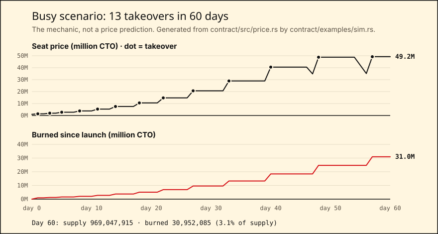

# $CTO: the memecoin where anyone can take over

$CTO is a memecoin on NEAR testnet with one CEO seat. This README is for hackathon judges and developers who want to try the app or check the contract.

**How the seat works:**

- To take the seat, you pay 1.4x what the current CEO paid.
- The old CEO gets 1.15x back. They make a profit when they lose the seat.
- The contract burns the other 0.25x. Each takeover makes the supply smaller.
- NEAR deletes the old CEO's voice key. When the old CEO tries to post as the coin, NEAR rejects the transaction.

Fired, but paid.

- **App:** <!-- app-url -->[ctotimes.xyz](https://ctotimes.xyz)<!-- /app-url -->
- **Coins:** [`cto.testnet`](https://testnet.nearblocks.io/address/cto.testnet) (main coin: price decay starts after 7 idle days and takes 7 days) · [`demo-cto.testnet`](https://testnet.nearblocks.io/address/demo-cto.testnet) (demo coin: 2 minutes, then 3 minutes)
- **Ticker:** $CTO. The on-chain symbol is `CTO` (demo coin: `CTOD`), so amounts read "1,400,000 CTO". Tokens on other chains also use the name $CTO. This coin is only `cto.testnet`.
- **Proof:** [CI runs all six test layers](https://github.com/cto-takeover/cto-memecoin/actions/workflows/ci.yml) · `npm run verify` (see [Verify the coins yourself](#verify-the-coins-yourself))
- Built at [NEAR Hackathon](https://nearhackathon.com) (Nov 2026), track **Memecoins With Mechanics**. Testnet only · no sale · no admin keys · open source (MIT).

## Try the demo in 60 seconds

You do not need a wallet. The app starts on the demo coin. Two demo accounts, ani and budi, sign transactions through a small demo relayer.

1. Open [ctotimes.xyz](https://ctotimes.xyz) in a private window.
   The **Front page** shows the CEO, the seat price, the total burned, and the coin's face.
2. Press **TAKE OVER**.
   The **Takeover desk** opens.
3. Select 4 face parts: background, eyes, mouth, and extra.
4. In **Play as**, keep the account that is not the CEO. The app selects it for you.
5. Press **TAKE THE SEAT**.
   One transaction pays the old CEO, burns the rest, and sets the face. It also deletes the old CEO's voice key and adds your voice key. The screen shows the real numbers from the chain.
6. Open the **Press office**.
7. Press **TRY POSTING AS** the old CEO.
   NEAR rejects the transaction with `AccessKeyNotFound`. Only then does the app show the **REJECTED BY NEAR** stamp, above NEAR's raw error. The page also shows what the old CEO paid, what they got back, and their profit.
8. To post as the new CEO, select a line and press **SIGN AS THE COIN**.
9. Open **Receipts**.
   Your browser reads the chain and checks three facts: zero full-access keys, supply = 1,000,000,000 − burned, and icon = the on-chain face. Then it shows the VERIFIED stamp. Each step links to the explorer. A chart shows a 60-day simulation of the price.

## Use the main coin with your own wallet

**Prerequisites:** a NEAR testnet wallet, for example MyNearWallet or Meteor.

1. In the app header, select **MAIN COIN · cto.testnet**.
2. Press **Connect wallet** and sign in with your testnet account.
3. On the **Takeover desk**, press **Claim 2,000,000 CTO**.
   The faucet gives each account 2,000,000 CTO one time.
4. Select 4 face parts and press **TAKE THE SEAT**.
5. Press **Download cto-voice-key.json** and keep the file.
   This file is your voice key. Your browser made it, and only you have it.

> **Note:** If you open the Press office in a different browser, the app asks for your voice key file. Load the file that you downloaded in step 5.

> **Note:** One faucet claim pays for a seat price up to 2,000,000 CTO. After a few takeovers on the main coin, the price can be higher than that. The Takeover desk then shows when the price starts to fall. Until then, use the demo coin.

## How it works

| Rule | On chain |
| --- | --- |
| Take the seat | Call `take_seat(face, new_ceo_key, max_price)` and attach exactly 0.25 NEAR. The price is 1.4x what the CEO paid. If the seat is empty, the price is 1,000,000 CTO. If the price is now above `max_price`, the call fails with "price moved". |
| Payout and burn | The old CEO gets 23/28 of the price, which is 1.15x what they paid. The contract burns the rest. All math uses exact integers and rounds down, so `payout + burned == price` always. |
| Face | The contract builds the token icon (`ft_metadata.icon`) from 4 parts with 8 options each: 4,096 fixed faces. Nobody can upload an image, so a rude face is not possible. |
| Voice | The voice key is a function-call access key **on the coin's own account**. It can only call `announce(line)`. Each line is one of 24 fixed lines, and the contract fills in the numbers. There is no free text on chain. |
| Firing | The takeover transaction deletes the old voice key and adds the new one. When the old CEO tries to post, the NEAR protocol rejects it with `AccessKeyNotFound`. No server makes this decision. |
| No stuck seat | If nobody takes the seat for 7 days, the price falls to the floor (1,000,000 CTO) over the next 7 days. The demo coin uses 2 minutes and 3 minutes. |
| No owner | The coin accounts have **no full-access keys** after deploy. Nobody can upgrade the code, mint tokens, or change the config. The supply can only go down. |

## Why this needs NEAR

On most chains, "who speaks for the coin" is a server setting or an off-chain social account. On NEAR, an account can hold **access keys with limits**: a key that can call one method on one contract, with a gas allowance. A contract can also add and delete keys on its own account.

CTO uses both. The coin's voice is a function-call key on `cto.testnet` itself, limited to `announce`. The takeover transaction deletes the old key and adds the new one in the same batch. So when the old CEO tries to post, the NEAR protocol rejects the transaction before any contract code runs (`AccessKeyNotFound`). No server and no admin decides this.

## The economics, honestly

The track scores the mechanic, so here is who gains and who pays.

| Who | What happens |
| --- | --- |
| A CEO who is pushed out | Gets 23/28 of what the next CEO pays. Before decay, that is 1.15x what they paid: +15%. |
| The last CEO in a run | If nobody takes the seat, the price decays to the 1,000,000 CTO floor after 14 days. The next taker pays 1,000,000, and the CEO gets 821,428 CTO back. A CEO who paid 2,744,000 loses about 1,922,571 CTO. This is the cost of being the face. |
| Every holder | Each takeover burns 5/28 of the price (0.25x what the old CEO paid). The first takeover of a vacant seat burns all of it. Supply only goes down. |

What each number does:

- **Opening price 1,000,000 and faucet 2,000,000.** One faucet claim pays for any of the first three seat prices (1,000,000, 1,400,000, and 1,960,000), so a new holder can play right away.
- **1.4x and 1.15x.** Every takeover pays the leaving CEO a fixed +15%, and it always burns.
- **7 days, then 7 days of decay.** A rival has a week to answer. After that, the seat can never get stuck at a price nobody pays.

The 60-day simulation runs the contract's own `price.rs` (spec 5, `npm run verify` checks it):



| Scenario | Takeovers | Burned by day 60 | Share of supply |
| --- | --- | --- | --- |
| busy | 13 | 30,952,085 | 3.1% |
| random (seed 42) | 18 | 52,315,320 | 5.2% |
| quiet | 4 | 1,664,286 | 0.17% |
| abandoned | 3 | 1,600,000 | 0.16% |

The burn is real but slow. It grows with how hard people fight for the seat, not with time. The busy run reaches a 49M seat price. A single faucet claim (2,000,000) cannot pay that, so long runs need holders who were paid out before, or who pool CTO. See [Limits](#limits).

## Verify the coins yourself

You do not need keys for this check.

**Prerequisites:**

- Git and Node.js 26.
- Optional: Rust 1.95 and cargo-near 0.23. Without them, lines 1–7 print SKIP and link to CI.

1. Clone the repo:
   ```bash
   git clone https://github.com/cto-takeover/cto-memecoin && cd cto-memecoin
   ```
2. Install the dependencies:
   ```bash
   npm ci && npm --prefix web ci
   ```
3. Run the checks:
   ```bash
   npm run verify
   ```
   The output shows 12 PASS lines:

<!-- verify:start -->
```text
PASS  price math: 1,000,000 -> 1,400,000 / 1,150,000 / 250,000
PASS  face changes in ft_metadata
PASS  old CEO paid exactly 1.15x
PASS  supply falls exactly 0.25x
PASS  old key rejected on chain (AccessKeyNotFound)
PASS  new key can only call announce
PASS  price decays after the idle window, floor holds
PASS  full-access keys on cto.testnet: 0
PASS  full-access keys on demo-cto.testnet: 0
PASS  deployed code matches res/cto.wasm
PASS  total supply = 1,000,000,000 - burned
PASS  simulation follows the contract math
12 passed · no keys needed
```
<!-- verify:end -->

Lines 1–7 run the contract's unit tests and a full story on a local NEAR sandbox.

The live lines read testnet over JSON-RPC. They check these facts:

- Each coin has zero full-access keys, and at most one voice key that can only call `announce`.
- The hash of the deployed code is equal to the hash of `res/cto.wasm`.
- The on-chain `get_config` is equal to `reference/constants.json`.
- The supply is equal to 1,000,000,000 minus all burns in the history.

To run only the live checks, run `npm run verify:live`.

## Run the tests

| Layer | Command | What it proves |
| --- | --- | --- |
| 1. Unit | `cargo test -p cto --lib` | Price math, face ids and SVG, line text |
| 2. Sandbox | `cargo test -p cto --test sandbox` | The full story with real transactions, keys, and errors |
| 3. Relayer | `npm run test:relayer` | Key derivation, request checks, and NEAR errors that pass through unedited |
| 4. Live | `npm run verify:live` | The deployed coins match the code and the rules |
| 5. Simulation | `cargo run -p cto --example sim -- --check` | The chart data follows the contract math |
| 6. End-to-end | `npm run test:e2e:local` (sandbox) · `E2E_BASE_URL=… npm run test:e2e` (deployed app) | Real clicks on desktop and phone, reduced motion, and axe accessibility checks |

To run all the layers, run `npm run test:all`. CI runs all six layers on each push.

## Run the app locally

**Prerequisites:**

- Node.js 26.
- Rust 1.95. The version comes from `rust-toolchain.toml`.
- cargo-near 0.23.

1. Install the dependencies:
   ```bash
   npm ci && npm --prefix web ci
   ```
2. Start a local NEAR sandbox:
   ```bash
   npm run dev:chain
   ```
   The sandbox has both coins and the accounts ani and budi. The command writes `web/.env.local`.
3. In a second terminal, start the app:
   ```bash
   npm run dev
   ```
   The app and the demo relayer run on http://localhost:5173.

## Repo layout

| Path | Contents |
| --- | --- |
| `contract/` | The Rust contract (near-sdk 5): `price.rs` (pure math), `face.rs`, `lines.rs`, `events.rs`. Also `tests/sandbox.rs` and `examples/sim.rs`. |
| `res/cto.wasm` | The deployed build |
| `web/` | The Vite + React app. `web/api/demo/` is the demo relayer (Vercel functions). |
| `verify/`, `e2e/` | `npm run verify` and the Playwright tests |
| `reference/` | `constants.json` (every number), the 24 lines, and the face parts |
| `specs/`, `docs/` | The build specs, the PRD, the design system, and the [build kit](docs/BUILD-KIT.md) |
| `scripts/deploy.md` | The deploy runbook with the exact commands |

## Limits

- **Testnet only.** CTO has no value, and nobody sells it. The faucet gives each account 2,000,000 CTO one time.
- **The faucet does not stop sybils.** It allows one claim per NEAR account, but anyone can make many testnet accounts and pool their CTO. The main coin's pool holds 500 claims in total (1,000,000,000 / 2,000,000). A script could empty it, and nothing can refill it. That is acceptable for a testnet demo with no value. A real launch would need a proof-of-personhood check or a sale, and both are out of scope.
- **The main coin's price can be higher than one faucet claim.** One claim pays up to 2,000,000 CTO. From the fourth takeover in a run (2,744,000), a taker needs CTO from earlier payouts or from other holders. Otherwise they wait for the decay.
- **The demo relayer holds the keys of ani and budi.** These are testnet accounts for the demo. The relayer signs for any visitor on the demo coin. It also derives their voice keys from a server secret.
- **The demo relayer has limits** so that one visitor cannot use up the demo. The relayer reads these limits from the chain, so they hold on every serverless instance:
  - It signs a takeover only when the price is at most 4x the floor (4,000,000 CTO). Above that, it says when the price comes back down.
  - It allows at most 20 takeovers per hour across all visitors, and one takeover each 10 seconds.
  - It stops signing for an account that has less than 2 NEAR left.
  - It also allows 6 requests per minute for each IP address. This limit is in memory, so it holds only on a best-effort basis.
- **The main coin never uses the demo relayer.** You sign with your own wallet, and your browser makes your voice key.
- **Wallets can cache token icons.** A wallet can show an old face for some time. The chain (`ft_metadata`) always has the current face.
- **`res/cto.wasm` is a non-reproducible build** (`cargo near build non-reproducible-wasm`). Docker was not available for `reproducible-wasm`. `npm run verify` still checks that the hash of the deployed code is equal to the hash of the committed file.
- **Explorer links** use the transaction hash if this browser saw the transaction or nearblocks indexed it. If not, they link to the coin's account page.
- **The demo coin's price goes up** if many people take the seat within a few minutes. After 5 minutes with no takeover, it goes back to the floor.

## Built with

All code in this repo was written during the hackathon. The first commit is from Nov 10, 2026.

- **AI:** [Claude Code](https://claude.com/claude-code) (Anthropic) wrote the contract, app, relayer, tests, and scripts from the specs in `specs/`. The workflow is in [docs/BUILD-KIT.md](docs/BUILD-KIT.md). The builder made the product decisions, ran the gate test, reviewed the code, and did every deploy and signing step. The demo video's voice is [Kokoro](https://github.com/hexgrad/kokoro) TTS (Apache-2.0), generated locally.
- **Contract:** [near-sdk](https://github.com/near/near-sdk-rs) 5.30 and near-contract-standards (NEP-141, NEP-145, NEP-148). Tests use near-sandbox and near-api.
- **App and relayer:** React 19, Vite, Tailwind CSS, [near-api-js](https://github.com/near/near-api-js), [NEAR Wallet Selector](https://github.com/near/wallet-selector) (MyNearWallet, Meteor), and @noble/curves. The app runs on Vercel.
- **Tests:** Vitest, Playwright, and axe-core.
- **Chain access:** FastNEAR testnet RPC, with drpc as a fallback. Explorer links go to nearblocks.

## License

MIT. See [LICENSE](LICENSE).
